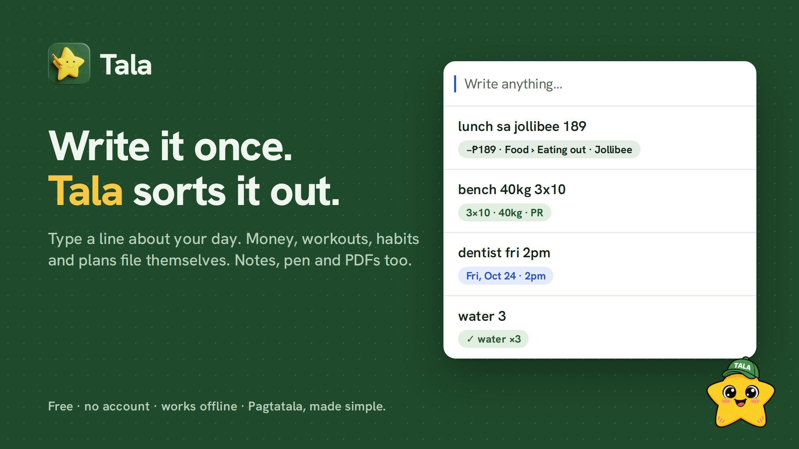

<p align="center">
  
</p>

<p align="center">
  
</p>

<h1 align="center">Tala</h1>

<p align="center">
  <strong>Pagtatala, made simple.</strong><br/>
  A local-first notebook for typed notes, handwriting, PDF annotation and the small
  records of daily life: tasks, events, money, habits and workouts.
</p>

<p align="center">
  <a href="https://tala.lorenzmalabanan.com/"></a>
  <a href="https://github.com/E1yWrites/tala/releases/latest"></a>
  <a href="https://github.com/E1yWrites/tala/actions/workflows/ci.yml"></a>
  <a href="LICENSE"></a>
  <a href="https://github.com/E1yWrites/tala/stargazers"></a>
</p>

<p align="center">
  
  
  
  
  
  
  
  
  
  
  
  
</p>

---

No account, no server, no tracking. Notes live in your browser's IndexedDB, work
offline, and leave your device only when *you* export them.

## Features

- **Pages**: a note is an ordered list of pages, each with its own typed text and handwriting; continuous scroll, page strip, templates.
- **Ink**: pressure-aware pen, highlighter and pencil, lasso, undo, zoom, snap-to-shape, wet-ink rendering.
- **PDF**: import and annotate pages, export a note back to PDF (ink as vector paths).
- **Lecture audio**: record while you write; tap a stroke to replay what was said.
- **Pagtatala entries**: type `P150 lunch gcash`, `@ thu 2pm dentist`, `[ ] essay due fri` or `✓ water 3` and the page becomes the record. English and Taglish dates.
- **Planner**: Today, Upcoming, Tasks, Money (safe to spend), Habits and Workouts, all re-read from your lines. No separate database.
- **Organize**: folders, tags, stars, pins, archive, trash, instant search, command palette.
- **Your data**: `.tala` zip backups (merge or replace), device-only storage, light/dark themes.

## Try it

Open **<https://tala.lorenzmalabanan.com/>** and install it from your browser (iPad Safari, Android Chrome, desktop Chrome/Edge).

Windows installers are on the [Releases](https://github.com/E1yWrites/tala/releases/latest) page. They are not code-signed: check them against the `SHA256SUMS` file attached to each release.

```bash
sha256sum -c SHA256SUMS
```

## Develop

Node 18+ (CI uses 20).

```bash
git clone https://github.com/E1yWrites/tala.git
cd tala
npm ci
npm run dev        # http://localhost:5173
npm run typecheck  # strict; unused code fails
npm test           # Vitest (fake-indexeddb)
npm run build      # typecheck + production build -> dist/
npm run preview    # http://localhost:4173
npm run test:e2e   # Playwright flows against a running preview (build first)
```

### Desktop (Tauri v2)

```bash
# Debian/Ubuntu prerequisites
sudo apt install libwebkit2gtk-4.1-dev build-essential curl wget file \
  libxdo-dev libssl-dev libayatana-appindicator3-dev librsvg2-dev
curl --proto '=https' --tlsv1.2 -sSf https://sh.rustup.rs | sh

npm run app:dev     # native window with HMR
npm run app:build   # installers -> src-tauri/target/release/bundle/
```

An iOS build via Capacitor lives in `ios/` and is dormant until App Store launch.

## How it is put together

`src/library/` is the only code that writes note data. Stores are plain state, and library calls update them optimistically, then persist through one serialized queue. Details, gotchas and the data model are in [CLAUDE.md](CLAUDE.md); design decisions are in [docs/adr](docs/adr).

## Contributing and security

Issues and pull requests are welcome, see [CONTRIBUTING.md](CONTRIBUTING.md). To report a vulnerability, see [SECURITY.md](SECURITY.md). Privacy: [public/privacy.html](public/privacy.html).

## License

[MIT](LICENSE) © 2026 e1yu
